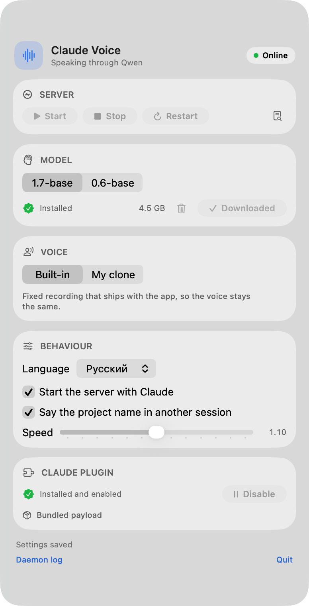
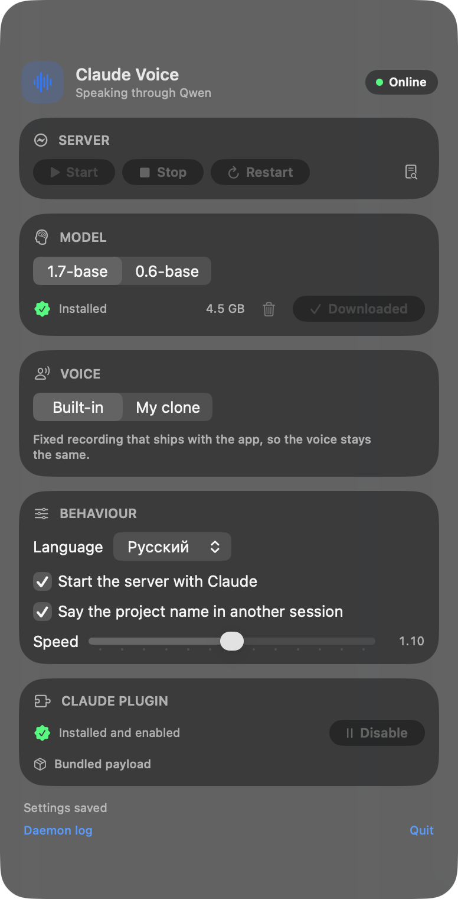

# Claude Voice

Speaks one short line per assistant message in Claude Code — including the
narration between tool calls — with a local Qwen3-TTS voice on Apple Silicon.

```
assistant stream ──MessageDisplay hook──▶ unix socket ──▶ daemon ──▶ TTS ──▶ sox
        │                                                   │
        └── displayContent without <say> line                └── per-session queue
```

The product and the repository are called **Claude Voice**. The plugin's
manifest id stays `voice-brief`: plugin names starting with `claude-` are
reserved by the validator, so the id and the on-disk paths keep that name.

## Screenshots

<p align="center">
  
  
</p>

## Install

https://github.com/VladYankovenko/claude-voice

```bash
git clone https://github.com/VladYankovenko/claude-voice.git
cd claude-voice
./installer/install.sh
```

Interactive; add `--yes` for defaults. Flags:

```
--preset 0.6-base        model preset (see below)
--clone sample.wav       build a voice reference right away
--name narrator          reference name, default "default"
--port 8011              server port
--venv PATH              reuse an existing Python environment
--skip-model             do not download weights
--no-plugin              do not touch the Claude plugin
```

The installer checks `arm64`, creates an isolated environment in
`~/Library/Application Support/voice-brief/venv`, installs
[mlx-audio](https://github.com/Blaizzy/mlx-audio), downloads the chosen model
(2.3–4.3 GB), starts the server, and writes the plugin settings.

Sizes on a 16 GB M1 Pro: environment 477 MB, models 2.3 GB (0.6B) or 4.3 GB
(1.7B), peak memory ~4 GB and ~10 GB respectively.

Install the plugin without the installer, if a server already runs:

```bash
claude plugin install voice-brief --marketplace "$PWD" --scope user
# or straight from GitHub:
#   claude plugin install voice-brief \
#     --marketplace VladYankovenko/claude-voice
claude plugin configure voice-brief@voice-brief-local
python -m mlx_audio.server --host 127.0.0.1 --port 8011
```

An installed copy from a folder marketplace is read from this folder itself, so
edits reach a running session with `/reload-plugins`.

## Menu bar app

`app/` builds a native menu bar app (macOS 26, Liquid Glass) that owns the whole
setup: start/stop the server, pick and download a model with progress, clone a
voice from a file, change language and behaviour, install and enable the Claude
plugin. It carries its own CPython runtime and the plugin payload, so the DMG
needs no repository and no Xcode Command Line Tools.

```bash
cd app
./build.sh            # builds build/Claude Voice.app and build/ClaudeVoice.dmg
open "build/Claude Voice.app"
```

First launch creates the Python environment inside
`~/Library/Application Support/voice-brief/venv` (about a minute, needs network)
and installs `mlx-audio`. Then download a model from the app (2.3 or 4.3 GB) and
press Install in the plugin section. Claude Code itself must already be
installed; the app finds the `claude` CLI in PATH.

The DMG is ad-hoc signed: on another Mac, open it once with right click → Open
(or `xattr -d com.apple.quarantine`). Distribution to strangers needs a
Developer ID certificate and notarisation.

## Setup skill

The repository ships a skill that walks a person through the install in plain
language: it checks the machine, asks which model and voice they want, runs the
installer, verifies the result and troubleshoots silence.

It is available twice: `skills/voice-setup/` ships with the plugin, and
`.claude/skills/voice-setup/` works when Claude is started inside this folder
before the plugin is installed. Ask for "voice setup", or run `/voice-setup`.

## Models and voices

| preset | model | size | speed |
|---|---|---|---|
| `1.7-base` | `Qwen3-TTS-12Hz-1.7B-Base` | ~4.3 GB | best quality, ~10 GB peak |
| `0.6-base` | `Qwen3-TTS-12Hz-0.6B-Base` | ~2.3 GB | about twice as fast, ~4 GB peak |

Both are cloning models: they have no speaker table, so the voice always comes
from a reference wav. Without one the model invents a speaker per request and
the voice drifts between phrases. The plugin ships a fixed reference
(`assets/default-voice.wav` + `.txt`) and uses it whenever `refAudio` is `none`;
a path in `refAudio` replaces it with your own clone.

## Clone a voice

```bash
# from a file, 8.8 s starting at 69.9 s
node cli/voice-setup.js --file sample.mp4 --start 69.9 --duration 8.8 \
  --name narrator --apply

# from the microphone
node cli/voice-setup.js --mic 12 --name me --apply
```

Pipeline: `highpass=80` → `lowpass=8000` → `afftdn` spectral denoise →
`silenceremove` (−45 dB) → `loudnorm` (−18 LUFS) → 24 kHz mono PCM →
whisper transcript for `ref_text`.

Clean input matters more than any filter: 3–10 seconds, one speaker, no music,
same language as the output. References live in
`~/Library/Application Support/voice-brief/refs/<name>/`.

`--apply` writes `refAudio` and `refText` into the plugin config; without it the
files are built and the command prints what to apply.

The transcript comes from whisper on the TTS server, which downloads the model
on the first request (~1.6 GB, then cached). If the server is down or the
download is impossible, the command stops with exit code 2: the reference wav is
kept, the config is untouched. Two ways around it:

```bash
node cli/voice-setup.js --file sample.wav --name narrator \
  --ref-text "exact words spoken in the clip" --apply

node cli/voice-setup.js --file sample.wav --name narrator --allow-empty-ref-text --apply
```

The second is not recommended: Qwen clones poorly without `ref_text`.

## What gets spoken

| Event | Phrase |
|---|---|
| `MessageDisplay` | the `<say>` line of an assistant message, hidden from the screen |
| `UserPromptSubmit` | nothing — cancels whatever is playing (barge-in) |
| `Notification` | `permission_prompt` → «Клод просит разрешение», `idle_prompt` → «Закончил, жду задачу», `agent_completed`, `agent_needs_input`, `elicitation_dialog` |
| `PreCompact` | «Контекст переполняется, сжимаю историю» |
| `StopFailure` | «Ошибка API, ответ не пришёл» |
| `SubagentStop` | «Агент <type> закончил» / "Agent <type> finished" |

Phrases follow the language of your messages, not a hardcoded one: the hook
reads recent user messages from the transcript, skipping tool results and
injected system reminders, and picks the template. Russian
and English ship; anything else falls back to English. Synthesis gets its
`lang_code` from the text it is about to speak, so mixed sessions sound right.

`SessionStart` starts the local server when it is not running (`autostart=0`
turns that off) and spawns the per-session daemon. The server is never stopped
by the plugin: the model stays warm for the next session.

## Several sessions at once

One speaker is shared by every Claude session on the machine: they all post to
the same daemon, so two sessions cannot talk over each other.

- phrases queue globally and play one at a time;
- a phrase from a different project than the last one heard is prefixed with the
  project name — `beta: проверяю тесты`;
- priority events (permission, idle, agent, context, API error) jump the queue
  and interrupt another session's phrase, announced with its project name;
- typing a new prompt cancels only that session's queue, and stops playback only
  if that session is the one speaking.

The TTS server is one per machine, shared by every session. `SessionStart`
registers the session with its process id, `SessionEnd` removes it (`/clear`
does not count as leaving); two minutes after the last session is gone the
plugin stops the server if it started it, and the speaker exits too.

Nothing is left holding gigabytes when a Claude process dies badly:

- every session registers the CLI's pid, and the speaker prunes sessions whose
  process is gone — a crashed Claude leaves no `SessionEnd` behind;
- the speaker stops the server on `SIGTERM`/`SIGINT`;
- a hook that finds the speaker's socket refusing connections starts it again,
  so a crashed speaker costs one phrase, not a restart;
- a watchdog process watches the speaker's socket and stops the server after
  three missed checks, covering a speaker killed with `SIGKILL`;
- only a server the plugin started is touched: its pid must be alive and its
  command line must be the mlx-audio server, so a hand-started one survives. The next session starts both again,
paying the model load time on its first phrase. Set
`CLAUDE_VOICE_SERVER_IDLE_MS` to change the two minutes.

Turn the prefix off with `announceProject=0`.

## How it works

1. `output-styles/voice.md` (applied by `force-for-plugin: true`) tells the model
   to emit exactly one `<say>…</say>` line before each tool call and at the end
   of an answer.
2. The `MessageDisplay` hook forwards each streamed `delta`, the session id and
   the project name to the shared speaker over a unix socket, and returns
   `displayContent` with the `<say>` line stripped — the line is heard, not seen.
3. The speaker reassembles tags split across batches, queues phrases from every
   session, and streams PCM into `sox play` (or `ffplay` / `afplay`).
4. Audio is cached in `$CLAUDE_PLUGIN_DATA/cache/pcm`, keyed by engine, preset,
   voice, reference and text.

The hook never blocks on synthesis: `MessageDisplay` holds each batch until the
hook exits (10 s cap), so the hook only writes a few bytes and returns.

The plugin posts to `POST {ttsUrl}/v1/audio/speech`:

```json
{
  "model": "mlx-community/Qwen3-TTS-12Hz-1.7B-Base-bf16",
  "input": "привет",
  "response_format": "pcm",
  "stream": true,
  "lang_code": "russian"
}
```

Response: chunked `audio/pcm` — 24000 Hz, mono, s16le, EOF ends it. Server
quirks the adapter respects:

- the field is `input`, not `text`;
- `response_format` defaults to `mp3` (needs ffmpeg), so `pcm` is always sent;
- `lang_code` defaults to `"a"`; Russian is `russian`, not `ru`;
- streaming and cloning are serialized server-side — the daemon is single-flight
  by design;
- `ref_audio` is an absolute path **on the server's machine**, `ref_text` is
  required for a stable clone and is re-encoded on every request.

## Requirements

- Apple Silicon Mac, macOS 13+.
- Python 3.11+ and `ffmpeg` (`brew install ffmpeg`); sox recommended
  (`brew install sox`) — it drains the audio device before exiting, while
  ffplay's `-autoexit` drops its queued tail at EOF, heard as a cut word.
- Node 18+ for the plugin hooks and CLI.

## Configuration

`plugin.json` → `userConfig` (`CLAUDE_PLUGIN_OPTION_<KEY>` in the environment):

| key | default | meaning |
|---|---|---|
| `engine` | `mlx` | `mlx` (HTTP stream) or `system` (macOS `say`) |
| `modelPreset` | `1.7-base` | `1.7-base`, `0.6-base` |
| `ttsUrl` | `http://127.0.0.1:8011` | base URL of the mlx-audio server |
| `sampleRate` | `24000` | PCM rate, must match the model |
| `language` | `auto` | spoken language: `auto`, `russian`, `english` |
| `autostart` | `1` | start the local server on session start |
| `refAudio` / `refText` | `none` | `none` = bundled stable voice, or an absolute path + its transcript for your own clone |
| `announceProject` | `1` | prefix a phrase with the project name when another session speaks |

Escape hatches for `--plugin-dir` runs:

```bash
CLAUDE_VOICE_PRESET=0.6-base                  # overrides modelPreset
CLAUDE_VOICE_MODEL=mlx-community/...          # overrides the preset entirely
CLAUDE_VOICE_REF_AUDIO=/abs/path/voice.wav
CLAUDE_VOICE_REF_TEXT="текст референса"
CLAUDE_VOICE_LANG=russian
CLAUDE_VOICE_SPEED=1.0
CLAUDE_VOICE_MAX_TOKENS=1200
CLAUDE_VOICE_STREAM_INTERVAL=0.5              # seconds of audio per chunk
CLAUDE_VOICE_PLAYER=sox                       # sox | ffplay | file
CLAUDE_VOICE_TTS_PATH=/v1/audio/speech
CLAUDE_VOICE_TTS_TIMEOUT=60000
CLAUDE_VOICE_SERVER_IDLE_MS=120000            # stop the TTS server after this idle time
CLAUDE_VOICE_PRUNE_MS=60000                   # how often dead sessions are pruned
CLAUDE_VOICE_WATCHDOG_MS=30000                # how often the watchdog probes the speaker
CLAUDE_VOICE_SAY_VOICE=Milena                 # system engine voice
CLAUDE_VOICE_SAY_RATE=200
```

## Manual check

```bash
CLAUDE_VOICE_ENGINE=system node scripts/say.js "проверка связи"
node scripts/say.js "проверка через сервер"
CLAUDE_VOICE_PRESET=0.6-base node scripts/say.js "проверка пресета"
claude plugin validate "$PWD"
```

## Files

```
.claude-plugin/plugin.json   manifest, userConfig
hooks/hooks.json             SessionStart / MessageDisplay / UserPromptSubmit / …
output-styles/voice.md       the <say> protocol
installer/
  install.sh                 one-command setup
  bootstrap.py               venv, model download, server, plugin config
  models.json                model presets
cli/voice-setup.js           clone a voice: denoise, VAD trim, transcript
scripts/
  models.js                  presets shared by plugin and installer
  md-hook.js                 MessageDisplay: fast forward + displayContent
  barge-in.js                UserPromptSubmit: cancel playback
  notify.js                  Notification: permission/idle/agent events
  precompact.js              PreCompact: context warning
  stop-failure.js            StopFailure: API error
  subagent-stop.js           SubagentStop: agent finished
  session-start.js           spawn the shared speaker, start the TTS server
  session-end.js             last session leaving starts the idle countdown
  daemon.js                  shared speaker: queue, labels, preemption, cache
  watchdog.js                stops the server if the speaker disappears
  player.js                  sox stream / ffplay / afplay, with stop()
  tts/mlx.js                 HTTP streaming adapter
  tts/system.js              macOS say
  lang.js                    phrase language: transcript, env, config
  say.js                     manual test
```

## Debug

- daemon log: `$CLAUDE_PLUGIN_DATA/daemon.log`
  (default `~/.claude/plugins/data/voice-brief-voice-brief-local/daemon.log`)
- server log: `~/Library/Application Support/voice-brief/server.log`
- installer settings: `~/Library/Application Support/voice-brief/config.json`
- `claude --debug` — look for `MessageDisplay` lines; if the event never fires,
  your CLI build does not support it.
- no sound? `node scripts/say.js` isolates the engine from the hook plumbing.

## Known limits

- `<say>` tags split across streamed batches may leave a stray character on screen.
- `system` engine cannot stream or clone; it is a fallback only.
- Cloning is only as clean as the reference: denoise helps, music does not.
- The local server has no authentication — keep it on `127.0.0.1`.
- Notification phrases exist for Russian and English only; other languages get
  the English template, while synthesis still uses the right `lang_code`.
- The queue caps at 4 phrases per session; older narration is dropped, not
  delayed.
- After the last session closes, the server is stopped in two minutes: the next
  session's first phrase waits for the model to load (10-20 s).
- Only a server this plugin started is stopped; one started by hand is left
  alone. To stop everything by hand:
  `pkill -f mlx_audio.server`.
